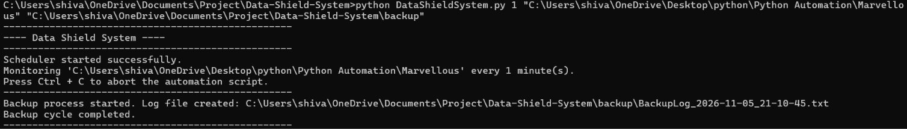
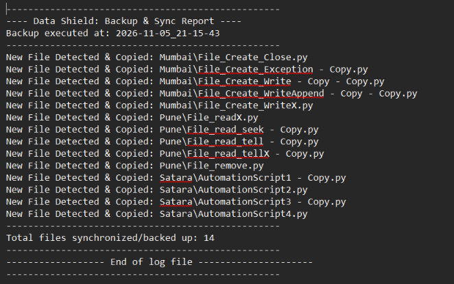

# 🛡️ Data Shield System - Automated Backup & File Monitoring System


**Data Shield System** is a Python-based automated file backup and synchronization tool designed to monitor directories and maintain updated copies of important files.

The system uses **MD5 checksum comparison** to detect newly created and modified files, automatically synchronizes them with a specified backup directory, and generates timestamped log reports for every backup operation.

By combining Python's file-handling capabilities, hashing algorithms, and automated task scheduling, Data Shield reduces repetitive manual backup operations and provides an efficient approach to directory-level data management.

---

## 🚀 Key Features

- **Automated File Backup:** Automatically copies files from a source directory to a designated backup directory at configurable time intervals.

- **MD5 Checksum-Based Change Detection:** Generates MD5 checksums to compare source and destination files and identify modifications.

- **New File Detection:** Identifies newly added files and automatically copies them to the backup destination.

- **Modified File Detection:** Detects changes in existing files by comparing their MD5 checksums and updates the corresponding backup copies.

- **Recursive Directory Traversal:** Scans nested directories while maintaining the original folder structure in the backup destination.

- **Automated Task Scheduling:** Uses Python's Schedule library to execute backup operations periodically without requiring manual intervention for every backup.

- **Detailed Logging System:** Generates timestamped log reports containing backup details, detected files, copying errors, and synchronization statistics.

- **Command-Line Interface:** Provides a simple CLI with configurable backup intervals, source and destination paths, and built-in help instructions.

---

## ⚙️ How It Works

Data Shield follows a systematic backup and synchronization workflow.

### 1. Configure Backup Directories

The user provides three command-line arguments:

- **Time Interval:** Frequency of backup execution in minutes.
- **Source Directory:** Folder containing the original files.
- **Destination Directory:** Folder where backup copies are maintained.

### 2. Schedule Automatic Execution

The Python Schedule library schedules the backup function to execute repeatedly at the specified time interval.

### 3. Scan Source Directory

The application uses Python's `os.walk()` function to recursively traverse the source directory and identify files within all nested folders.

### 4. Detect New and Modified Files

The application performs two types of checks:

**New File Detection**
- Checks whether a corresponding file exists in the destination directory.
- If the file does not exist, it is identified as a new file.
- The new file is copied to the backup destination.

**Modified File Detection**
- Calculates the MD5 checksum of the source file.
- Calculates the MD5 checksum of its corresponding destination file.
- Compares both checksums.
- If the checksums differ, the destination file is updated.

### 5. Synchronize Files

The application uses `shutil.copy2()` to copy new or modified files while preserving available file metadata.

The original directory structure is maintained in the destination directory.

### 6. Generate Backup Reports

After every backup cycle, the application generates a timestamped log file containing:

- Backup execution date and time.
- Newly detected and copied files.
- Modified files that were updated.
- Errors encountered during file copying.
- Total number of files synchronized.

### 7. Repeat Automatically

After completing a backup cycle, the scheduler waits for the next configured interval and repeats the process.

---

## 📸 Project Screenshots

### 1. Automated Backup Execution

The following screenshot demonstrates the application running through the command-line interface, initializing the scheduler, and executing the backup process.



### 2. Generated Backup Log Report

The application generates detailed log reports showing newly detected files, successful synchronization operations, and the total number of files backed up.



---

## 🧰 Technologies & Libraries Used

| Technology / Library | Purpose |
|---|---|
| Python 3 | Core programming language |
| os | Directory traversal and file management |
| sys | Command-line argument handling |
| time | Time intervals and timestamps |
| hashlib | MD5 checksum generation |
| shutil | File copying and metadata preservation |
| schedule | Periodic task automation |

---

## 📂 Project Structure

```text
Data-Shield-System/
│
├── DataShieldSystem.py       # Main automation script
│
├── requirements.txt          # Project dependencies
│
├── .gitignore                # Git ignored files
│
├── README.md                 # Project documentation
│
├── LICENSE                   # MIT License
│
└── screenshots/
    ├── backup.png            # Backup execution screenshot
    └── log-report.png        # Generated backup report
```

---

## 💻 Installation & Setup

Follow these steps to run Data Shield System on your local machine.

### Prerequisites

- Python 3.x installed.
- pip package manager.
- Basic knowledge of command-line operations.

### Step 1: Clone the Repository

```bash
git clone https://github.com/bemo-codes/Data-Shield-System.git
```

Navigate to the project directory:

```bash
cd Data-Shield-System
```

### Step 2: Create a Virtual Environment

```bash
python -m venv venv
```

Activate the virtual environment.

**Windows:**

```bash
venv\Scripts\activate
```

**Linux / macOS:**

```bash
source venv/bin/activate
```

### Step 3: Install Dependencies

```bash
pip install -r requirements.txt
```

The project requires the following external Python package:

```text
schedule
```

Other modules used in the application are included in Python's standard library.

---

## ▶️ Usage

Data Shield operates through a command-line interface.

### 1. Display Help Information

To view the functionalities supported by the application:

```bash
python DataShieldSystem.py --h
```

### 2. Display Usage Instructions

To understand the required command-line arguments:

```bash
python DataShieldSystem.py --u
```

### 3. Start Automated Backup

Use the following command format:

```bash
python DataShieldSystem.py <Time_Interval> <Source_Folder> <Destination_Folder>
```

**Example (Windows):**

```bash
python DataShieldSystem.py 1 "C:\Users\YourName\Documents" "D:\DataShieldBackup"
```

This command configures the application to:

- Monitor the Documents directory.
- Execute a backup operation every 1 minute.
- Detect newly created and modified files.
- Synchronize detected changes with the backup directory.
- Generate timestamped backup log reports.

**Important:**

- The first scheduled backup runs after the configured interval, not immediately.
- The application must remain running for scheduled backups to continue.
- Press `Ctrl + C` to stop the automation script.
- Keep the destination directory outside the source directory to avoid scanning backup files recursively.
- The parent directory of the destination must already exist if the destination folder itself needs to be created.

---

## 📊 Backup Logging System

Data Shield automatically generates a separate log file for every backup cycle.

### Example Directory Structure

```text
DataShieldBackup/
│
├── BackupLog_2026-11-05_21-10-45.txt
├── BackupLog_2026-11-05_21-15-45.txt
│
├── Mumbai/
│   ├── File_Create_Close.py
│   └── File_Create_Write.py
│
├── Pune/
│   └── File_read.py
│
└── Satara/
    └── AutomationScript1.py
```

### Sample Backup Log

```text
--------------------------------------------------
       Data Shield: Backup & Sync Report
Backup executed at: 2026-11-05_21-15-43
--------------------------------------------------
New File Detected & Copied: Mumbai\File_Create_Close.py
New File Detected & Copied: Mumbai\File_Create_Exception.py
New File Detected & Copied: Pune\File_read.py
New File Detected & Copied: Satara\AutomationScript1.py
--------------------------------------------------
Total files synchronized/backed up: 14
--------------------------------------------------
             End of log file
--------------------------------------------------
```

The actual log entries depend on the files detected during each backup cycle.

---

## 🧠 Core Concepts Implemented

This project demonstrates the practical implementation of several Python programming concepts:

### 1. File Handling
- Reading files in binary mode.
- Opening and closing files.
- Copying files between directories.

### 2. Directory Management
- Checking directory existence.
- Creating directories.
- Recursive directory traversal.
- Maintaining relative folder structures.

### 3. Hashing Algorithms
- Generating MD5 checksums using `hashlib`.
- Comparing file hashes.
- Detecting file modifications through checksum comparison.

### 4. Automation & Scheduling
- Scheduling recurring tasks.
- Executing scheduled functions.
- Managing continuous execution loops.

### 5. Exception Handling
- Handling file access errors.
- Managing file copying exceptions.
- Handling invalid command-line arguments.

### 6. Logging & Reporting
- Generating timestamped log files.
- Recording backup operations.
- Tracking synchronization counts and errors.

---

## ⚠️ Current Limitations

- The application performs periodic directory scanning rather than real-time filesystem event monitoring.
- It detects new and modified files but does not delete destination files when their source counterparts are removed.
- MD5 is used for file change detection, not cryptographic security or protection against deliberate file tampering.
- Backup files are not encrypted.
- The application does not currently provide file restoration functionality.
- The Python script must remain running for scheduled execution to continue.
- The destination directory should be separate from the source directory.

---

## 🔮 Future Enhancements

Potential improvements for future versions include:

- **Email Notifications:** Send notifications after successful or failed backup operations.
- **Incremental Backup Optimization:** Improve backup efficiency by processing only necessary file changes.
- **File Restoration:** Allow users to restore previously backed-up files.
- **Backup Compression:** Compress backup directories using ZIP archives.
- **GUI Dashboard:** Introduce a graphical interface for monitoring backup operations.
- **SHA-256 Integration:** Introduce stronger hashing algorithms for integrity verification.
- **Configurable Exclusions:** Allow users to exclude specific file types and folders.
- **Cloud Storage Integration:** Support remote backup destinations.
- **Advanced Error Handling:** Improve recovery mechanisms for failed backup operations.

---

## 👨‍💻 Author

**Shivam Ramesh Kurlekar**

GitHub: [@bemo-codes](https://github.com/bemo-codes)

Project Repository: [Data Shield System](https://github.com/bemo-codes/Data-Shield-System)

---

## 📄 License

This project is licensed under the **MIT License**.

See the [LICENSE](LICENSE) file for more information.

---

<p align="center">
  Built with Python 🐍 | Automated for Reliability 🛡️
</p>
